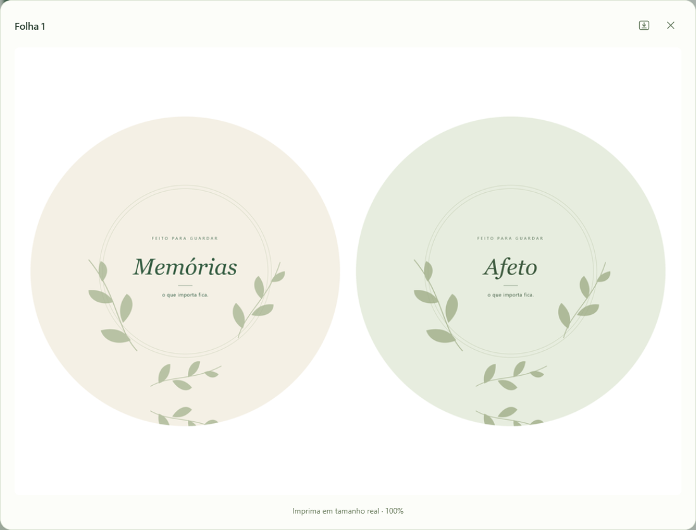

# Usar o Moldura

Baixe o `Moldura-Setup-<versão>.exe` na página de [versões oficiais](https://github.com/redlab-coder/moldura/releases/latest) e execute o instalador. A instalação é por usuário, com atalho no menu Iniciar e desinstalação pelas configurações do Windows. A interface abre no navegador padrão e o ícone fica na bandeja, ao lado do relógio. Não precisa instalar Python ou conectar uma conta. A edição e a exportação funcionam offline. Windows 10/11 de 64 bits.

Depois de instalado, o Moldura consulta novas versões em segundo plano, baixa o instalador e verifica seu SHA-256. A atualização é aplicada somente depois que você encerra normalmente o aplicativo. Não fecha sua sessão para atualizar e não exige baixar/substituir o EXE manualmente. Na bandeja, **Verificar atualizações** permite consultar o estado. Sem conexão, o programa continua funcionando e tenta novamente depois.

A cópia portátil **Moldura-v8.exe** também está disponível na mesma página; ela funciona sem instalação e não aplica atualizações automáticas. A base portátil v7 está preservada na [versão 0.7.0](https://github.com/redlab-coder/moldura/releases/tag/v0.7.0).

Clique no ícone para abrir a interface. Com o botão direito, escolha **Abrir Moldura** ou **Encerrar Moldura**. Abrir o executável novamente reutiliza o mesmo processo e a mesma porta. O serviço escuta apenas em `127.0.0.1`: outros computadores da rede não têm acesso. As versões anteriores foram preservadas. Exporte sua sessão antiga antes de encerrá-la e passe a usar o atalho da versão instalada. A bandeja e o cabeçalho identificam a versão em execução.

1. Clique em **Adicionar fotos** ou arraste arquivos para a área indicada.
2. Selecione uma foto na coluna esquerda. Arraste a imagem na prévia para enquadrar, use o zoom e ajuste as cores. O contorno pontilhado delimita a área visível do modelo escolhido. **Guias** mostra/oculta as marcações; **Centralizar** reposiciona sem alterar zoom ou cores. O botão **?** reúne as orientações de uso. Clique na prévia e use as setas para mover um pixel da imagem original; Shift + seta move dez pixels.
3. Digite o valor exato no campo ao lado de cada ajuste. Brilho, contraste e saturação vão de -100 a +100; nitidez de -100 a +200; zoom de 1,00 a 5,00. O botão **↺** zera somente aquele ajuste (zoom retorna a 1,00). As setas do teclado no campo numérico fazem ajustes de uma unidade. Durante o movimento, uma prévia rápida acompanha sua mão; ao soltar, a prévia final é calculada pelo mesmo processamento usado na exportação.
4. Confira as folhas abaixo; clique em uma para ampliar. O ícone de download ao lado de fechar baixa somente essa folha, em JPG na resolução final a 300 DPI. Clique em uma foto ou no espaço da lista e use ↑/↓ para selecionar a anterior/seguinte; a seleção acompanha a rolagem. Os pequenos botões de seta de cada linha continuam alterando a ordem das fotos nas folhas.
5. Clique em **Exportar** no topo da interface. Uma folha baixa como JPG; várias folhas baixam juntas em ZIP, contendo os JPGs individuais. O navegador salva na pasta de downloads ou pergunta onde salvar, conforme suas configurações.
6. Você pode fechar ou recarregar a aba e reabrir pelo ícone, usando o mesmo navegador/perfil: fotos, ajustes e ordem retornam enquanto o Moldura continuar ativo na bandeja. Os ajustes e identificadores da sessão ficam no armazenamento local do navegador; os arquivos completos ficam em uma área temporária local, removida ao excluir as fotos ou encerrar normalmente o aplicativo. Exporte antes de **Encerrar Moldura**, desligar ou reiniciar o computador. Essa recuperação não substitui um arquivo de projeto e não funciona em outro navegador/perfil. Somente uma aba edita a sessão por vez em navegadores compatíveis com Web Locks, como o Edge testado. Outra aba mostra a sessão para consulta; clique em **Usar nesta aba** para transferir a edição. A aba anterior passa a somente consulta e não sobrescreve os ajustes ao fechar.

## Conferir uma folha

A prévia ampliada reúne a folha e o botão para baixar somente aquele JPG.

## Arquivos e limites

Aceita JPG, PNG, WebP, BMP e TIFF (primeira página). Transparência é composta sobre branco; a orientação EXIF é corrigida. Perfis ICC válidos são convertidos a sRGB. Arquivos de até 50 MB e 60 megapixels; o lote aceita até 100 fotos e 4 GB de arquivos originais em armazenamento temporário. O cache de imagens decodificadas é limitado a 160 MiB; isso não inclui a memória transitória necessária para processar uma foto e compor a folha. É necessário espaço livre no disco temporário. HEIC e RAW devem ser convertidos antes.

## Versão e atualizações

A versão em execução aparece ao lado do nome Moldura. Quando uma nova versão estiver sendo baixada, o cabeçalho mostra **Baixando atualização**. Depois da verificação, mostra **Atualização disponível**; a instalação acontece ao encerrar normalmente o aplicativo. A consulta também pode ser feita em **Verificar atualizações**, na bandeja do Windows.

[← Documentação](README.md) · [Moldura](../README.md)
